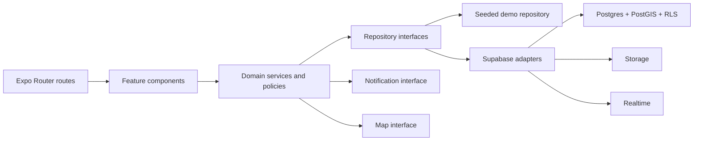
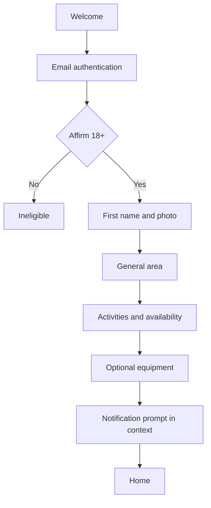
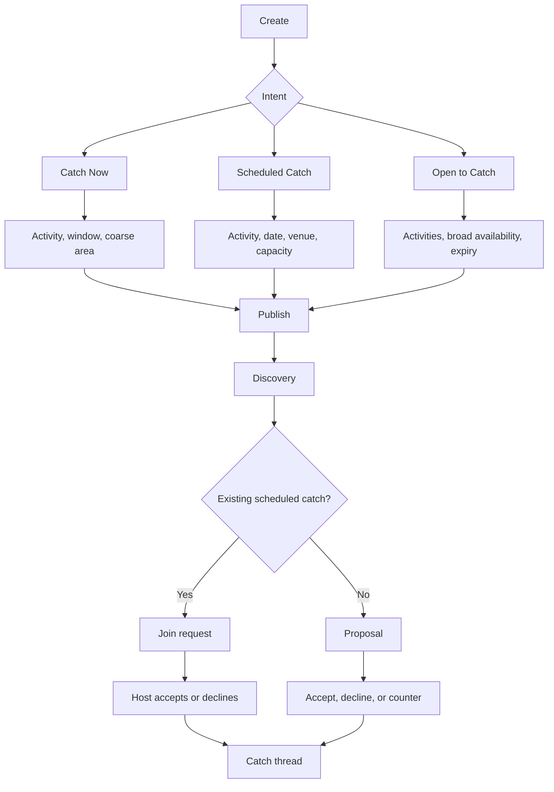
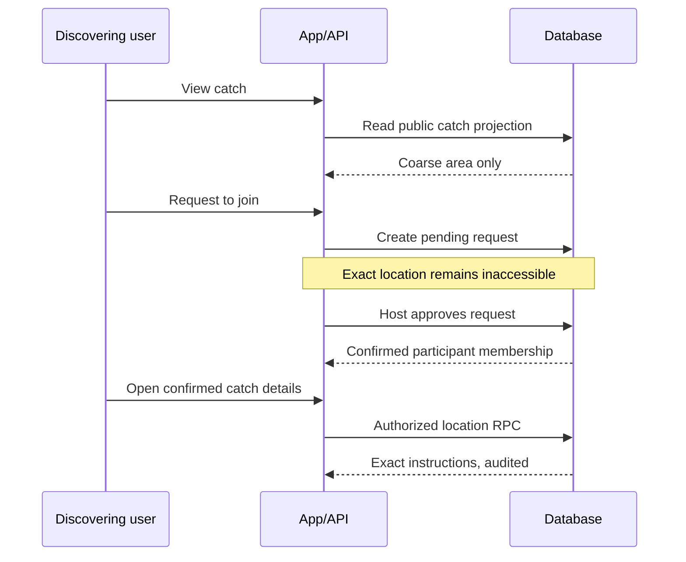

# Architecture

## Recommendation

Use a feature-oriented Expo application with thin route files, reusable UI
primitives, explicit domain types, repository interfaces, and Supabase adapters.
TanStack Query can be introduced with the real backend in Phase 2; Phase 1 keeps
seeded queries synchronous and small. Local ephemeral UI state belongs in React
state/context. Server state must not be copied into a global client store.



## Primary flows

### Onboarding



### Catch creation and joining



### Private location release



## Domain model

The schema groups stable cross-activity fields into normalized tables and puts
activity-specific, validated extension data in JSONB. This avoids a destructive
redesign for new activities without turning every field into untyped JSON.

Core identity:

- `profiles` — public-safe user identity and coarse area.
- `user_preferences` — radii, privacy, rating visibility, age affirmations.
- `user_activity_preferences` — activities, subtypes, intensity.
- `availability_windows` — broad recurring windows with expiration.
- `equipment_items` and `equipment_photos`.

Catalog and place:

- `activity_types` and `activity_subtypes`.
- `venues`, `venue_capabilities`, and `venue_amenities`.
- `private_location_secrets` — isolated exact details, never selected by public APIs.

Coordination:

- `catches` — scheduled, Catch Now, and accepted-proposal events, differentiated by `kind`.
- `catch_participants` — host/member roles and participation status.
- `join_requests`.
- `open_to_catch_listings` plus listing activities.
- `catch_proposals` and `proposal_revisions`.
- `catch_mates` and `catch_mate_invites` — one-way saved connections and
  single-use private friend codes; profile joins are exposed only through
  authorization-checked functions.
- `catch_messages` and `catch_status_history`.
- `invite_links`.

Trust and operations:

- `blocks`.
- `reports` and `moderation_actions`.
- `ratings` with constrained subject/aspect combinations.
- `reliability_events` as an append-only audit trail.
- `notification_preferences` and `device_push_tokens`.

`CatchCardSummary` is a privacy-aware read model rather than a source-of-truth
table. It should be exposed through a view or RPC so rating visibility is applied
at query time.

## Important state machines

Proposal:

`pending -> accepted | declined | countered | expired | withdrawn`

A counter creates an immutable revision; acceptance must target the latest
revision and atomically create a catch.

Catch:

`draft -> open -> full -> confirmed -> completed | canceled | disputed`

Catch Now entries also expire. Completion and cancellation are auditable status
events, not destructive updates.

Participant:

`requested -> approved | declined | withdrawn`, then
`approved -> attended | no_show | left`.

## RLS strategy

- Deny by default on every user-data table.
- Public discovery uses safe database views/RPCs, not direct reads of profile or
  location internals.
- A user can update only their own profile and preferences.
- Catch hosts can mutate their catch and resolve its pending join requests.
- Confirmed participants can read their catch messages and authorized private
  location material.
- A block in either direction removes discovery, profile, proposal, join, and
  messaging access.
- Reports are insertable by the reporter but readable only by that reporter and
  privileged moderation roles; the reported party cannot read them.
- Service-role keys never ship in the app.

## Proposed folder structure

```text
app/
  _layout.tsx
  index.tsx
  (auth)/
  (tabs)/
  create/
  catch/
src/
  components/
  constants/
  data/
  features/
  lib/
  providers/
  repositories/
  services/
  types/
  utils/
supabase/
  migrations/
  seed.sql
docs/
tests/
assets/
```

Route files compose screens; business rules live under `src/` so they can be
tested without rendering navigation.

## Data and state approach

- Supabase is the system of record.
- TanStack Query is recommended when remote reads begin, with scoped query keys
  and invalidation after mutations.
- React Hook Form plus Zod is recommended for multi-step creation and onboarding.
- Expo SQLite or AsyncStorage may cache non-sensitive preferences and query
  metadata, not exact private addresses.
- Realtime subscriptions are limited to active catch/proposal threads to avoid
  excess battery and connection use.

## Platform interfaces

- `CatchRepository` for discovery and catch mutations.
- `AuthService` for email now and social sign-in later.
- `MapService` for markers, search bounds, and directions.
- `NotificationService` for token registration and deep links.
- `AnalyticsSink` with a no-op default and typed event names.
